# SpotArena: Minecraft Server on AWS with Terraform


Build a Minecraft Java server on AWS with **one `terraform apply`**. The server configures itself on first boot, keeps world backups in a private S3 bucket, and needs **no SSH**: only the game port is open, and you get a shell through AWS Systems Manager (SSM).

This is a beginner-friendly **DevOps / Infrastructure as Code** project. It explains every step, shows real screenshots, and lists the real problems that came up while building it, so you can follow along even if you have never used Terraform.

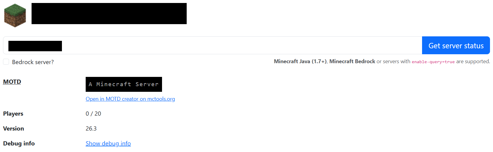

> **Status:** Phases 1 and 2 are complete and tested. Spot instances, idle shutdown, a Discord bot, and automatic recovery are planned (see the [roadmap](#roadmap)).

---

## Table of contents

- [What you get](#what-you-get)
- [Architecture](#architecture)
- [Repository structure](#repository-structure)
- [Prerequisites](#prerequisites)
- [Quick start](#quick-start)
- [Verify the server](#verify-the-server)
- [Cost and cleanup](#cost-and-cleanup)
- [How it was built](#how-it-was-built)
- [Troubleshooting](#troubleshooting)
- [Security notes](#security-notes)
- [Roadmap](#roadmap)
- [License](#license)

---

## What you get

| AWS resource | Purpose |
|---|---|
| **S3 bucket** (private, versioned, encrypted) | Stores world backups so the server itself is disposable |
| **IAM role + instance profile** | Lets the server use SSM, and read/write only its own bucket |
| **Security group** | Opens only TCP `25565` (Minecraft Java). No SSH, no other ports |
| **Launch template** | A saved recipe for the server, including the boot script |
| **EC2 instance** | Runs Minecraft inside Docker |

Defaults: region `us-east-1`, instance type `c7i-flex.large` (2 vCPU, 4 GiB RAM), Amazon Linux 2023, Minecraft given 2 GB of memory.

## Architecture

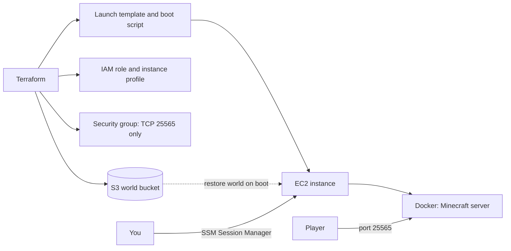

What the boot script (`terraform/user_data.sh.tpl`) does on first start:

1. Installs and starts Docker
2. Restores the world from S3 if a backup exists
3. Fixes file ownership (`chown -R 1000:1000 /data`) so the container can write its files
4. Starts the Minecraft container

## Repository structure

```
.
├── README.md
├── LICENSE
├── .gitignore
├── docs/
│   └── images/             screenshots used in this README
├── scripts/                helper scripts (added in later phases)
└── terraform/
    ├── providers.tf        AWS provider and Terraform version
    ├── variables.tf        region and project name
    ├── s3.tf               world backup bucket
    ├── iam.tf              instance role, SSM access, bucket policy
    ├── network.tf          security group (port 25565 only)
    ├── compute.tf          launch template and game server instance
    ├── user_data.sh.tpl    boot script run on the server's first start
    └── outputs.tf          bucket name, instance ID, server address
```

## Prerequisites

- An AWS account
- [AWS CLI v2](https://docs.aws.amazon.com/cli/latest/userguide/getting-started-install.html)
- [Terraform](https://developer.hashicorp.com/terraform/install) 1.6 or newer
- Git
- Optional: Minecraft Java Edition, to join the server

Tested with Terraform 1.14, AWS CLI 2.37, and the Terraform AWS provider 5.x on Windows 11.

### Set up AWS credentials safely

1. In the AWS console, create an IAM user for Terraform and attach a policy. This project was built with `AdministratorAccess` for learning. For real use, narrow it down.
2. Create an access key for the CLI and run `aws configure` (region `us-east-1`).
3. Check that it works:

   ```bash
   aws sts get-caller-identity
   ```

**Never commit access keys.** They live in `~/.aws/credentials`, outside this repo. If a key is ever exposed, delete it in IAM right away.

## Quick start

```bash
git clone https://github.com/eshajuware/aws-minecraft-server-terraform.git
cd aws-minecraft-server-terraform/terraform

terraform init
terraform plan -out=tfplan
terraform apply tfplan
```

When it finishes, Terraform prints:

```
instance_id    = "i-..."
server_address = "x.x.x.x:25565"
world_bucket   = "spotarena-world-<account-id>"
```

Wait about 3 to 4 minutes for the boot script to finish.

> **Windows tip:** use regular **Windows PowerShell**, not PowerShell ISE. ISE cannot handle interactive prompts such as `aws configure` or `terraform apply` asking for `yes`.

## Verify the server

**1. The container is healthy.** In the AWS console open EC2, select `spotarena-server`, then **Connect**, **Session Manager**, **Connect**, and run:

```bash
sudo docker ps
```

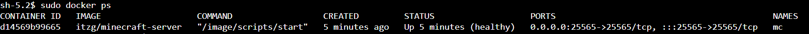

You want `mc` showing `Up ... (healthy)` and `0.0.0.0:25565->25565/tcp`. The `WARNING:` lines you may see in `docker logs mc` are normal Java messages.

**2. The port is reachable from the internet.**

```powershell
Test-NetConnection YOUR-IP -Port 25565
```

On Mac or Linux: `nc -zv YOUR-IP 25565`.

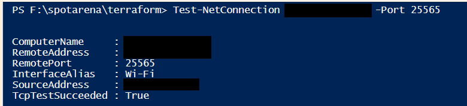

`TcpTestSucceeded : True` means players can connect.

**3. See it as a Minecraft server.** A web browser cannot show a Minecraft server. Opening `http://IP:25565` gives `ERR_EMPTY_RESPONSE`, which is normal and actually means the server answered. Use a Minecraft status checker such as mcsrvstat.us (type the address yourself), or join with **Minecraft Java Edition** at `YOUR-IP:25565`. Your game version must match the server (the status page shows it).

## Cost and cleanup

The server is **On-Demand by default** and bills by the hour while it runs, even with nobody online. Check current AWS pricing for your instance type, and turn it off when you are done.

Remove only the server, and keep the bucket, role, and security group:

```bash
terraform destroy -target=aws_instance.game
```

In Windows PowerShell, put the target in quotes, otherwise PowerShell splits it at the dot:

```powershell
terraform destroy '-target=aws_instance.game' -auto-approve
```

Remove everything: first empty the S3 bucket (use the **Empty** button in the S3 console, which also removes old versions), then run:

```bash
terraform destroy
```

Bring the server back at any time with `terraform apply`.

---

## How it was built

The project was built in two phases: first by hand in the console to understand each piece, then rewritten as Terraform.

### Phase 1: manual proof of concept

**1. IAM role for the server.** Trusted entity: AWS service, EC2. Policy: `AmazonSSMManagedInstanceCore`, which allows Session Manager access instead of SSH.

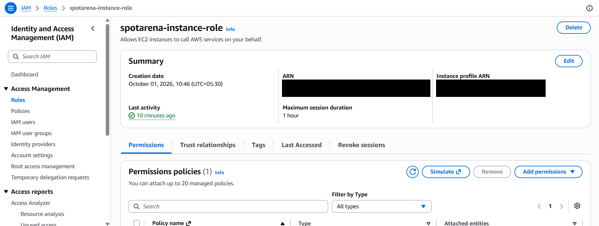

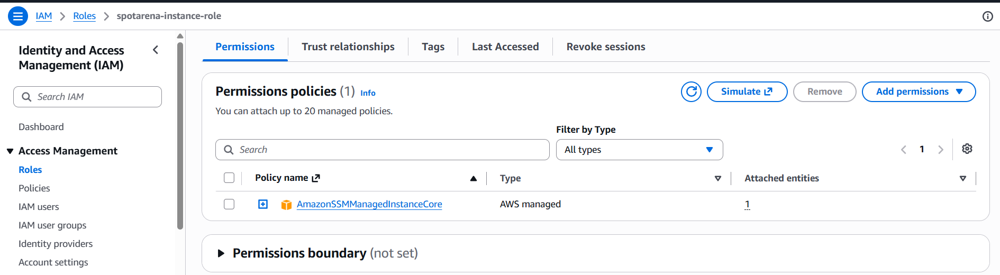

**2. Security group.** Only the game port is open, and the default SSH rule was deleted.

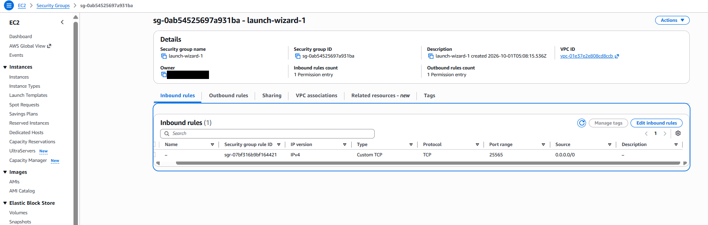

**3. Launch the instance.** Amazon Linux 2023, key pair set to "Proceed without a key pair", the IAM role attached, and a public IP enabled.

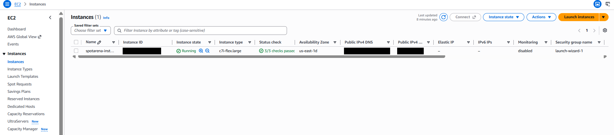

**4. Install Docker and start Minecraft** (run through Session Manager):

```bash
sudo dnf install -y docker
sudo systemctl enable --now docker
sudo docker run -d --name mc --restart unless-stopped \
  -p 25565:25565 -e EULA=TRUE -e MEMORY=2G \
  -v /data:/data itzg/minecraft-server
```

`EULA=TRUE` accepts Minecraft's end-user license agreement.

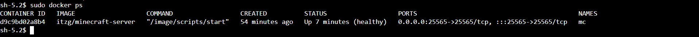

**5. Back up the world to S3.** Created a private bucket with versioning enabled, then gave the instance role access to that one bucket only (least privilege):

```json
{
  "Version": "2012-10-17",
  "Statement": [
    {
      "Effect": "Allow",
      "Action": ["s3:GetObject", "s3:PutObject", "s3:DeleteObject"],
      "Resource": "arn:aws:s3:::YOUR-BUCKET/*"
    },
    {
      "Effect": "Allow",
      "Action": "s3:ListBucket",
      "Resource": "arn:aws:s3:::YOUR-BUCKET"
    }
  ]
}
```

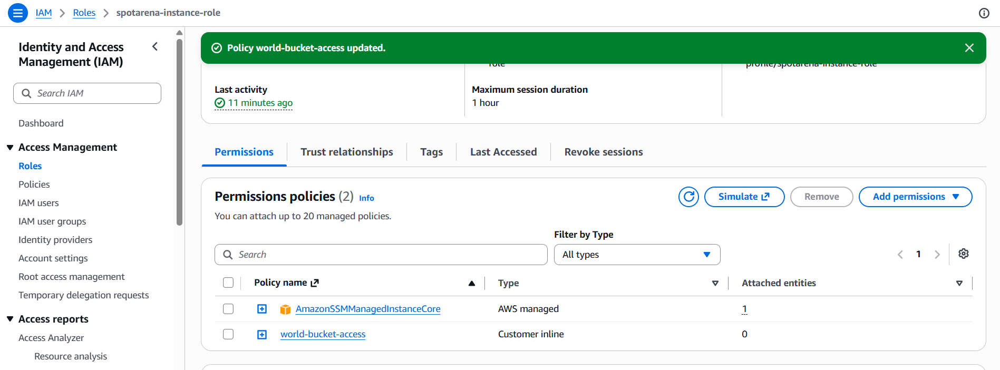

Save and restore:

```bash
# save
sudo aws s3 sync /data s3://YOUR-BUCKET/world/ --region us-east-1

# restore
sudo docker stop mc
sudo rm -rf /data/*
sudo aws s3 sync s3://YOUR-BUCKET/world/ /data/ --region us-east-1
sudo chown -R 1000:1000 /data      # needed, see Troubleshooting
sudo docker start mc
```

### Phase 2: everything as Terraform

The same setup, written as code in `terraform/`, so anyone can recreate it with one command. Terraform creates its own copies of the role, bucket, and security group, with names that work in any account (the bucket is `spotarena-world-<account-id>`).

```bash
terraform init
terraform plan -out=tfplan
terraform apply tfplan
```

The resources Terraform created (account details hidden):

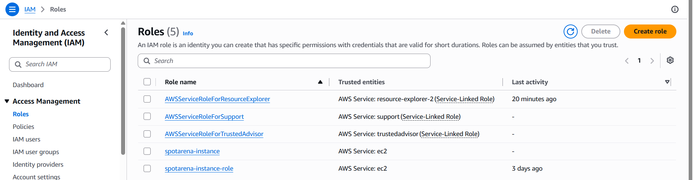

`spotarena-instance` was created by Terraform. `spotarena-instance-role` is the one made by hand in Phase 1.

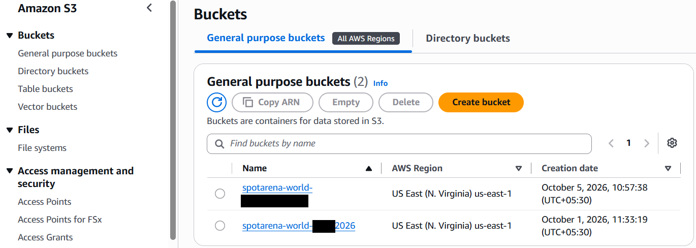

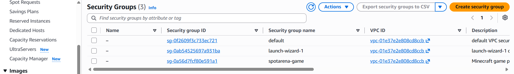

`spotarena-game` is the Terraform-managed group. It opens only TCP 25565.

Then the server started by itself from the boot script, with no manual fixes.

---

## Troubleshooting

Real problems hit while building this, and how they were fixed.

| Problem | Cause | Fix |
|---|---|---|
| Session Manager says **Not connected** | The IAM role was attached after the instance booted, so the SSM agent never picked it up | Attach the role at launch, or reboot the instance |
| `docker: command not found` after launch | The user data script was empty or not applied | Check `/var/lib/cloud/instance/user-data.txt`. The script must start with `#!/bin/bash` on line 1 |
| Container restarts forever with `AccessDeniedException: /data/server.properties` | A restore run as root left files that the container user (uid 1000) cannot write | `sudo chown -R 1000:1000 /data`, then start the container. The boot script now does this automatically |
| Browser shows `ERR_EMPTY_RESPONSE` for `IP:25565` | Browsers speak HTTP, Minecraft does not | This is normal. Use Minecraft, a status checker, or `Test-NetConnection` |
| `aws s3 ls` returns `AccessDenied` | The S3 policy was missing from the instance role | Add the bucket policy to the role and retry after a few seconds |
| `terraform init` says the directory is empty | Files were saved as `main.tf.txt` | In Windows, show file extensions and rename the files to `.tf` |
| `terraform plan` shows nothing to create | Same `.tf.txt` problem | Rename the files, then plan again |
| `aws configure` or the `yes` prompt shows no input | The terminal was PowerShell ISE | Use regular PowerShell, or `aws configure set` and `terraform apply tfplan` |
| `terraform destroy -target=aws_instance.game` fails with "Too many command line arguments" | PowerShell splits the argument at the dot | Quote it: `'-target=aws_instance.game'` |

## Security notes

- No secrets are stored in this repo. State files, plan files, `.tfvars`, and `.env` are git-ignored.
- Only TCP 25565 is open. There is no SSH access, and shell access goes through SSM.
- The S3 bucket blocks all public access, is versioned, and is encrypted.
- The instance role can only read and write its own world bucket.
- The instance requires IMDSv2.
- The Terraform user used while building had broad permissions for learning. Narrow them for real use.
- Screenshots in this repo have IP addresses and account IDs hidden.

## Roadmap

- [x] Phase 1: manual proof of concept (EC2, Docker, S3 backup and restore)
- [x] Phase 2: Terraform for bucket, IAM, security group, launch template, and server
- [ ] Safe world save script (`save-all` first, skip large library files)
- [ ] Spot instances (`use_spot = true`) for lower cost
- [ ] Automatic shutdown when no players are online
- [ ] Discord bot to start, stop, and check the server
- [ ] Recovery from Spot interruptions (EventBridge and Step Functions)
- [ ] Cost per player-hour dashboard
- [ ] CI/CD with GitHub Actions and OIDC (no stored keys)

